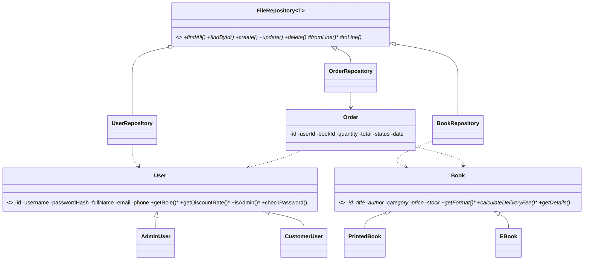

# BookNest – Online Bookstore Management System (SE1020 Project)

Java 17 · Spring Boot 3 · JSP Servlets · JSTL · Bootstrap 5 · **file storage (.txt)** – no database.

## Run it
**Requirements:** JDK 17+ and Maven (IntelliJ IDEA has both built in).

**IntelliJ:** File → Open → select this folder (the `pom.xml`) → let Maven import →
run `BookstoreApplication` (make sure the working directory is the project root).

**Terminal:** `mvn spring-boot:run`  → open <http://localhost:8080>

| Role | Username | Password |
|------|----------|----------|
| Admin | `admin` | `admin123` |
| Customer | `kasun` | `kasun123` |

Data files are created/updated in `./data/` (`users.txt`, `books.txt`, `orders.txt`). Delete them to reset.


Each member needs ≥3 CRUD operations and ≥3 UIs – every component above satisfies that.
Commit your own component from your own GitHub account so the commit history shows individual work.

## OOP concepts (for the viva)
- **Encapsulation / information hiding:** private fields + getters/setters in `User`, `Book`, `Order`; validation inside `Book.setPrice/setStock`.
- **Inheritance:** `AdminUser`, `CustomerUser` → `User`; `PrintedBook`, `EBook` → `Book`; `UserRepository`, `BookRepository`, `OrderRepository` → `FileRepository<T>`.
- **Polymorphism:** `calculateDeliveryFee()` and `getDetails()` differ for printed vs e-books; `getDiscountRate()` differs for admin vs customer; `OrderServlet` uses them through the `Book` / `User` base types.
- **Abstraction:** abstract classes `User`, `Book`; generic abstract `FileRepository<T>` hides all file I/O behind `create / findAll / findById / update / delete`.

## File handling
`FileRepository<T>` (in `repository/`) reads and writes pipe-separated lines (`type|id|title|...`), using `java.nio.file.Files`. Update/Delete rewrite the file; Create appends. Methods are `synchronized`.
Passwords are stored as SHA-256 hashes.

## Class diagram

Paste the block into <https://mermaid.live> to export a PNG for your report.

## Project layout
```
src/main/java/com/booknest/{model,repository,servlet,util,config}
src/main/webapp/WEB-INF/views/*.jsp
data/*.txt
```
